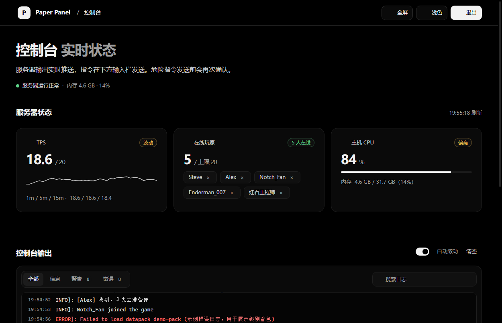
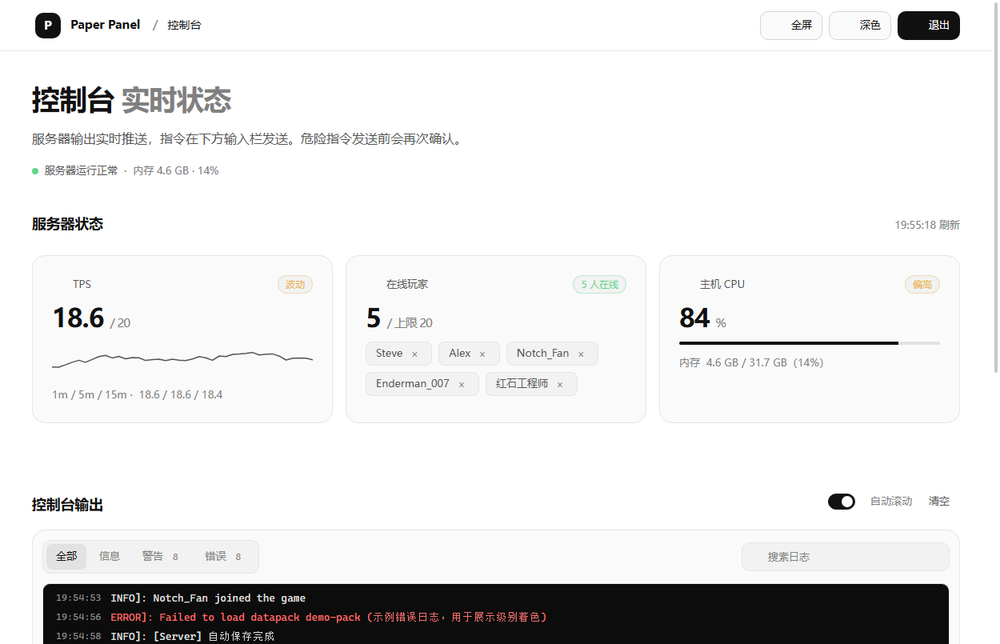
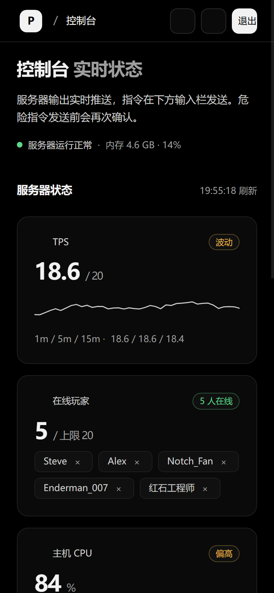
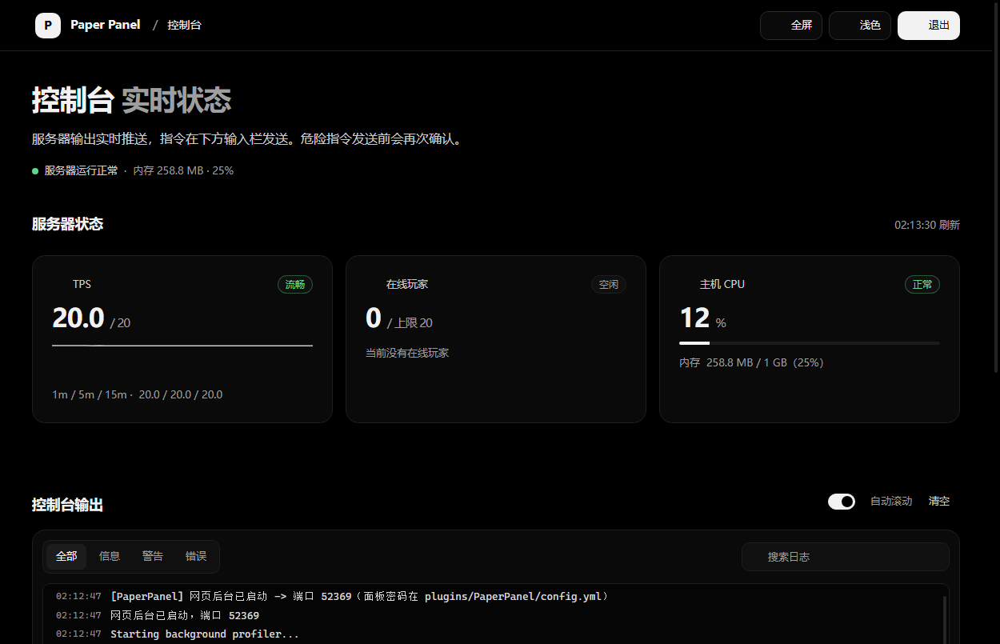

# PaperPanel

> 给 Minecraft Paper 26.3 服务器用的网页后台控制台：实时后台输出、下发指令、TPS / 在线人数 / 主机 CPU 一屏掌握。



同一个前端，两种运行形态：

| 形态 | 目录 | 适合 | 启动方式 |
| --- | --- | --- | --- |
| **Paper 插件版**（推荐） | `paper-panel-plugin/` | 服务器上开服即用，无需额外进程 | 把 `PaperPanel.jar` 放进 `plugins/` |
| **Node.js 独立版** | `paper-panel/` | 面板与服务端分开部署、或用 RCON 管已有服务器 | `node server.js`，零 npm 依赖 |

> 两个版本共用一个前端与一套安全模型，**不要同时监听 52369 端口**。

---

## 功能

**控制台**
- SSE 实时推送全服后台输出（插件版通过 log4j Appender 捕获；独立版尾随 `logs/latest.log`）
- 按级别分段筛选：全部 / 信息 / 警告 / 错误，警告与错误带实时计数
- 关键词搜索、自动滚动开关、一键清空、按级别着色、ANSI 颜色码自动剥离
- **全屏专注模式**：整屏只剩日志 + 指令栏，浏览器原生全屏，手机自动降级为铺满视口；`Esc` 或点按钮退出

**指令**
- 底部输入栏回车发送，支持 `↑` / `↓` 翻历史
- 可自定义、可删除的快捷指令条
- 危险指令（`stop` / `op` / `ban` / `kick` 等）二次确认
- 指令输出回显，执行结果同步写进日志流

**监控**
- TPS：大数字 + 趋势折线 + 1m / 5m / 15m 明细
- 在线玩家：人数 / 上限、玩家头像列表，点击名字填 `tell`，点 × 踢出
- 主机 CPU 占用仪表 + 内存占用条，均为服务端真实采集

**界面**
- 沿用 [zhangyuhexht.top](https://zhangyuhexht.top)（MCDRS）的设计语言：纯黑底、深灰面板、黑白灰为主、信号色只做点缀、16px 圆角、8px 间距节奏
- 单列布局，无侧边栏；默认深色，可一键切浅色；手机端适配（触控面积、安全区、单列堆叠）
- Toast 提示、状态胶囊、卡片 hover 柔光；全部零外链、零 CDN、零第三方前端库

---

## 截图

| 主界面 | 浅色模式 |
| --- | --- |
|  |  |

| 登录页 | 手机端 |
| --- | --- |
|  |  |



---

## 快速开始

### 方案 A：Paper 插件版（推荐）

1. 从 [Releases](../../releases) 下载 `PaperPanel.jar`（或自行构建）
2. 放到服务器的 `plugins/` 目录，启动服务器
3. 浏览器打开 `http://<服务器IP>:52369`
4. **首次启动会生成 `plugins/PaperPanel/config.yml`，立刻把 `password` 改掉**（见下方安全提示）

插件启用后会在服务器内部起一个轻量 HTTP 服务，日志捕获、指令执行、TPS / 玩家 / CPU 采集全部走 Bukkit API 与主线程调度，不需要 RCON，也不需要额外开进程。

### 方案 B：Node.js 独立版

要求 Node.js 16+，不需要 `npm install`：

```bash
cd paper-panel
node server.js
```

`config.json` 关键项：

| 配置项 | 说明 |
| --- | --- |
| `port` | 面板端口，默认 `52369` |
| `password` | 面板密码，**部署前必须修改** |
| `mock` | `true` 为演示模式（模拟日志与指标）；接真实服务器改为 `false` |
| `rcon.*` | 真实模式下的 RCON 地址、端口、密码 |
| `logPath` | 真实模式下 `logs/latest.log` 的**绝对路径** |
| `tls.*` | 证书与私钥路径，启用后直接以 HTTPS 提供服务 |

接真实服务器：在 Paper 的 `server.properties` 中开启 `enable-rcon=true` 并设置 `rcon.port` / `rcon.password`，然后把上述配置填好，`mock` 设为 `false`。

---

## 安全设计

> **上线前必做两件事：改掉默认密码 `change-me-123`；把面板放到 HTTPS 后面（启用 `tls` 或反向代理），不要裸奔公网。**

| 机制 | 说明 |
| --- | --- |
| 密码只在服务端 | 面板密码仅存在于 `config.json` / `config.yml`；前端代码、页面 DOM、网络请求里都不含明文密码 |
| 挑战应答登录 | 服务端下发一次性随机 `nonce` → 浏览器本地计算 `SHA256(nonce + ":" + SHA256(password))` 校验值 → 服务端用恒定时间比较校验。**明文密码既不落前端存储，也不进网络传输** |
| 防重放 | nonce 一次性、2 分钟过期，用完即销毁 |
| 会话 | 令牌只存在服务端内存，**刷新页面即失效，每次进入都要重新输密码**；可主动登出，令牌立即作废 |
| 暴力破解防护 | 同一 IP 连续失败 8 次锁定 300 秒，参数可配 |
| HTTP 安全头 | CSP `default-src 'none'`（`script-src`/`style-src` 仅 `'self'`）、`X-Frame-Options: DENY`、`X-Content-Type-Options: nosniff`、`Referrer-Policy: no-referrer`、`Permissions-Policy`、`COOP`、`Cache-Control: no-store` |
| 访问面收敛 | 静态资源白名单（无法读取 `config.json` 等文件，已测目录穿越）、请求体大小限制、指令长度限制、除登录/取 nonce 外所有接口强制鉴权 |

更完整的部署与威胁模型说明见 [SECURITY.md](SECURITY.md)。

---

## 构建插件

Paper 26.3 的 `paper-api` 是 Java 25 字节码，因此**编译需要 JDK 25 的 `javac`**（脚本会输出 `--release 21` 的字节码）；运行测试服同样使用 JDK 25。

```bash
cd paper-panel-plugin
bash build.sh      # 首次会自动下载编译依赖到 lib/，输出 PaperPanel.jar
```

`lib/` 与 `out/` 不入库（都是可再生的第三方 jar / 编译产物），依赖地址写在 `build.sh` 里。构建脚本会自动定位 `javac`；如需指定：

```bash
JAVAC=/path/to/jdk-25/bin/javac bash build.sh
```

前端两处副本保持一致，改动网页版后同步一次再打包：

```bash
cp paper-panel/public/{index.html,app.css,app.js,sha256.js} paper-panel-plugin/src/web/
cd paper-panel-plugin && bash build.sh
```

---

## 目录结构

```
.
├── LICENSE                     GPL-3.0 全文
├── README.md
├── SECURITY.md                 安全部署说明
├── docs/screenshots/           最新版界面截图
├── paper-panel/                Node.js 独立版
│   ├── server.js                鉴权 / RCON / 日志尾随 / SSE / 安全头
│   ├── config.json              服务端配置（含面板密码）
│   └── public/                  前端：index.html / app.css / app.js / sha256.js
└── paper-panel-plugin/         Paper 插件版
    ├── src/mcpanel/             Java 源码（HTTP 服务 / log4j 捕获 / 指标 / 指令）
    ├── src/web/                 内嵌前端（与网页版同步）
    ├── src/plugin.yml
    ├── src/config.yml           插件默认配置模板
    └── build.sh                 一键构建（自动下载依赖）
```

---

## 开源协议

本项目采用 **GNU General Public License v3.0**（[LICENSE](LICENSE)）。你可以自由使用、修改和分发，但基于本项目的衍生作品在分发时也必须同样以 GPL-3.0 开源、保留版权与许可声明，且不提供任何担保。

界面设计语言参考自 [zhangyuhexht.top](https://zhangyuhexht.top)。Minecraft 与 Paper 为各自权利人的商标，本项目与之无隶属关系。
